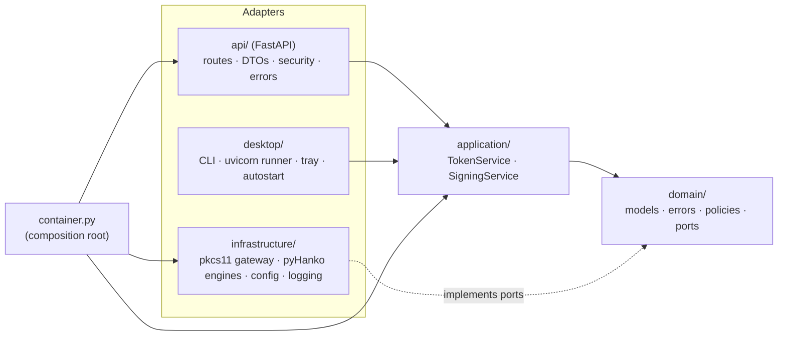
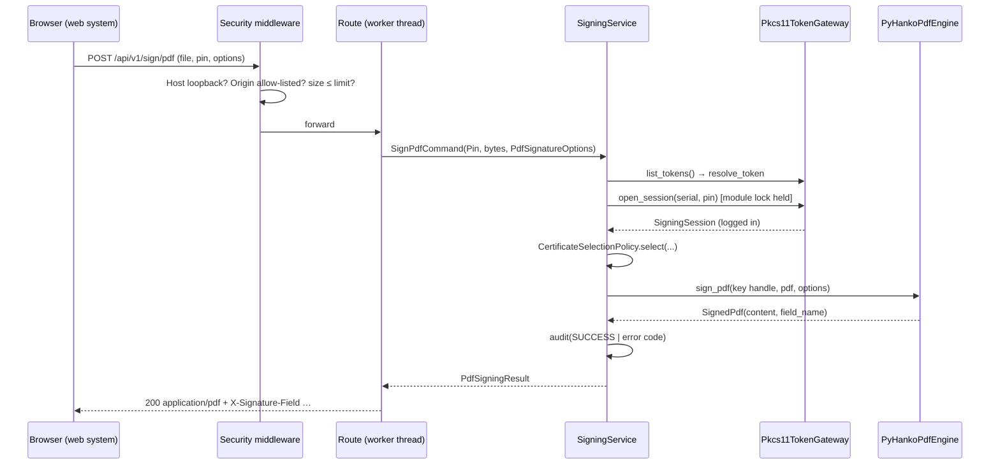

# Architecture

For developers maintaining or extending the agent.

## Layers (hexagonal / ports & adapters)

Dependencies point **inwards only**. `domain` is pure Python (no I/O, no frameworks);
`application` depends only on `domain`. `tests/unit/test_architecture.py` fails the build if
someone imports FastAPI, python-pkcs11, pyHanko, … into those layers.

## Ubiquitous language (domain)

| Term | Meaning |
|---|---|
| **Driver** | The token vendor's PKCS#11 module (`DriverStatus`). |
| **Token** | A connected, initialised USB token, identified by its `serial` (`TokenInfo`, `PinStatus`). |
| **Certificate** | An X.509 certificate on the token; `id_hex` (PKCS#11 `CKA_ID`) links it to its private key (`CertificateInfo`). |
| **Pin** | Secret value object — masked in `repr`, validated, revealed only at login. |
| **Signing session** | Logged-in, exclusive access to one token for one operation. |
| **Key handle** | Reference to a private key inside a signing session. |
| **Signature options** | `PdfSignatureOptions` (profile, stamp, timestamp, …), `CmsSignatureOptions`. |
| **Audit event** | One record per signing attempt (no PIN, no document — only its SHA-256). |

Policies (pure functions/classes in `domain/policies.py`):

* `resolve_token` — explicit serial, else the only token, else `TOKEN_AMBIGUOUS`.
* `CertificateSelectionPolicy` — explicit `cert_id`, else the single valid end-entity
  certificate with a private key and a signing key usage, preferring nonRepudiation;
  several candidates → `CERTIFICATE_AMBIGUOUS` (never guess who signs).

## Ports and their adapters

| Port (`domain/ports.py`) | Adapter | Test double |
|---|---|---|
| `TokenGateway`, `SigningSession`, `KeyHandle` | `infrastructure/pkcs11/gateway.py` (python-pkcs11) | `tests/support/fakes.py` |
| `PdfSigningEngine` | `PyHankoPdfEngine` | `RecordingPdfEngine` |
| `CmsSigningEngine` | `PyHankoCmsEngine` | `RecordingCmsEngine` |
| `AuditLog` | `LoggingAuditLog` (JSON lines → `audit.log`) | `RecordingAuditLog` |

## A signing request, end to end

## Concurrency model

* Route handlers are synchronous `def`s, so FastAPI runs them in a worker thread: blocking
  PKCS#11 calls never stall the event loop, and pyHanko's internal `asyncio.run` works.
  `pyhanko_engine._run_sync` also works if it is ever called from an event-loop thread.
* `Pkcs11Module` holds the single loaded driver and one re-entrant lock. Every PKCS#11 call
  (listing, login, signing) happens under it, because the driver is initialised without
  threading guarantees and the login state is shared per token. Waiting longer than
  `token_lock_timeout_seconds` → `TOKEN_BUSY`. Health checks never wait on it.
* Sessions are opened and closed per operation, so the token is never left logged in.

## SOLID in this code base

* **S** — each module has one reason to change: locator (where drivers live), module
  (driver lifecycle), gateway (PKCS#11 object model), engines (signature formats), routes
  (HTTP shape), security (browser threat model), tray/autostart (desktop integration).
* **O** — new vendor driver = new entry in `DRIVER_CATALOG`; new OS start-at-login = new
  `AutostartBackend`; new error = new `AgentError` subclass + one line in `STATUS_BY_ERROR`.
* **L** — every adapter honours its port's contract; fakes substitute for them in tests.
* **I** — small role interfaces (`TokenGateway` vs `SigningSession` vs `KeyHandle` vs engines).
* **D** — use cases depend on ports; only `container.py` knows the concrete classes.

## Extension recipes

* **Support another token**: add its module path to `DRIVER_CATALOG` (or tell users to set
  `pkcs11_module`). Nothing else changes.
* **New signature format** (e.g. XAdES): add an options value object + port in `domain`, a use
  case method in `SigningService`, an engine adapter in `infrastructure`, a route + DTO in `api`.
* **PIN pad readers**: `PinStatus.protected_authentication_path` is already reported; the
  gateway would call `token.open(user_pin=PROTECTED_AUTH)` when the request carries no PIN.
* **User confirmation before signing**: add a `SigningApproval` port (desktop dialog adapter)
  called by `SigningService._run` before `sign(...)`.

## Testing strategy

| Level | Where | What |
|---|---|---|
| Domain/application | `tests/unit/test_domain_*`, `test_application_services.py` | Rules and orchestration with fakes (100 % covered). |
| Adapters | `test_pkcs11_*`, `test_pyhanko_engine.py`, `test_config_and_paths.py` | Driver lifecycle with fake libraries; real pyHanko signing with an in-memory key, outputs validated cryptographically. |
| API | `test_api.py` | Routes, error contract, origin/host guards, CORS + PNA, size limits, no PIN echo. |
| Desktop | `test_desktop.py` | CLI, single-instance detection, tray with fake pystray, autostart for all 3 OSes. |
| Architecture | `test_architecture.py` | Inner layers stay framework-free. |
| End-to-end | `tests/integration/test_softhsm_e2e.py` | Real PKCS#11 (SoftHSM2): HTTP → token → signed PDF/CMS validated against a test CA, wrong PIN, concurrency, driver loaded once. |
